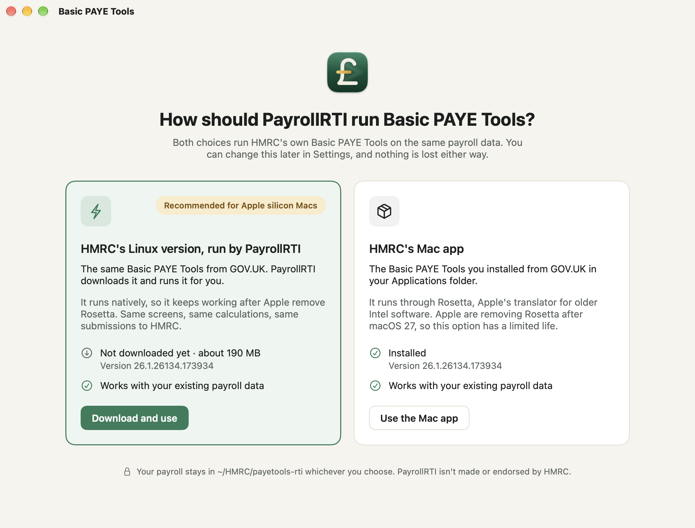

<p align="center">
  
</p>

<h1 align="center">PayrollRTI</h1>

<p align="center">
  Run HMRC's Basic PAYE Tools on macOS Sequoia, Tahoe and Golden Gate without the Terminal workaround.
</p>

---

## The problem

HMRC's free payroll software, [Basic PAYE Tools](https://www.gov.uk/basic-paye-tools) (BPT), doesn't open on
recent versions of macOS. HMRC [acknowledge the issue](https://www.gov.uk/government/publications/basic-paye-tools-service-availability-and-issues/basic-paye-service-availability-and-issues)
for macOS 15 Sequoia, 26 Tahoe and 27 Golden Gate. Their workaround, which you have to repeat every time you run
payroll, is:

1. Open Terminal.
2. `cd "/Applications/Basic PAYE Tools.app/Contents/Helpers/rti.app/Contents/MacOS"`
3. `./rti runserver 46729`
4. Open `http://127.0.0.1:46729/` in a browser.
5. Keep Terminal open the whole time, then press Ctrl+C when you've finished.

## What PayrollRTI does

PayrollRTI is a small native Mac app that does all of that for you:

- Starts HMRC's `rti` server in the background when you open it. It runs the same steps as BPT's own launcher, which
  the Terminal workaround skips:
  - setting up BPT's database on first use, and updating it after you install a new version of BPT
  - BPT's own backup when you quit
- Shows Basic PAYE Tools in its own window as soon as the server is ready, or in your usual browser if you'd rather.
- Stops the server cleanly when you quit: SIGTERM first, then SIGKILL if it hasn't exited within 5 seconds.
- Puts a status light in the menu bar (🟢 running, 🔴 stopped) with Start, Stop, Open in Safari, Check for Updates and
  Quit.
- Tells you when HMRC release a newer version of Basic PAYE Tools.
- Handles what BPT needs from a browser: confirmation dialogs, file pickers, downloads, and Print (use **PDF > Save as
  PDF** in the print sheet, as HMRC recommend for P45s, P60s and payslips).

**If BPT won't open on your Mac**, PayrollRTI is how you run it without using Terminal. **If BPT still opens normally**
(for example on macOS 14 Sonoma), PayrollRTI is a convenience rather than a fix. You get BPT one click away in the menu
bar, the option to start it at login, alerts when HMRC release a new version, and a clean shutdown with BPT's backup
on exit.

It doesn't modify, bundle or redistribute HMRC's software. You install Basic PAYE Tools from GOV.UK as normal, and
PayrollRTI runs the copy in your Applications folder. Your payroll data stays where BPT has always kept it.

PayrollRTI is an independent open-source project. It isn't made or endorsed by HMRC.

## Two ways to run it: HMRC's Mac installer or their Linux build

HMRC's Mac build is Intel-only, so on Apple silicon it runs under Rosetta, which Apple are withdrawing after
macOS 27. PayrollRTI can instead run **HMRC's Linux build of the same release**: the same Python program and
the same database format in a different wrapper. PayrollRTI downloads it from GOV.UK (about 190 MB), unpacks it
into `~/Library/Application Support/PayrollRTI/LinuxBuild/`, and runs it on a native Python runtime built into
the app. No Rosetta, nothing from HMRC modified or redistributed, and it uses your existing payroll data in
`~/HMRC/payetools-rti`.

Choose in **Settings > Basic PAYE Tools engine**, or on the screen PayrollRTI shows when nothing is set up yet:



Both engines share the database, so switching between engines of the same version is just a restart. Before
offering either, PayrollRTI reads the list of database changes your payroll data has had (Basic PAYE Tools
records every one) and compares it with what that copy of Basic PAYE Tools knows: a newer copy will update
the database when it starts, exactly as installing a new release does, and an older copy is refused, because
Basic PAYE Tools can't go back. When HMRC release a new version and you're on the Linux engine, the update
banner downloads it in PayrollRTI.

The Linux engine needs an Apple silicon Mac and a build of PayrollRTI that includes the runtime (the release
DMGs do). How it works is in [rehost/README.md](rehost/README.md).

## Screenshots


<sub>Basic PAYE Tools 26.1 running inside PayrollRTI on macOS 26.</sub>


<sub>If Basic PAYE Tools isn't installed, PayrollRTI tells you where to get it.</sub>

## Install

1. Install [Basic PAYE Tools](https://www.gov.uk/basic-paye-tools) from GOV.UK if you haven't already. It must be in
   `/Applications`, which is where HMRC's installer puts it.
2. Download the latest `PayrollRTI-x.y.z.dmg` from [Releases](https://github.com/seatofthepants-net/payrollrti/releases).
3. Open the DMG and drag **PayrollRTI** into **Applications**.
4. Open PayrollRTI from Applications or Launchpad.

Release builds are signed under the seatofthepants.net Ltd Apple Developer account (Team ID 632444ASFF) and
notarised by Apple, so they open without Gatekeeper warnings. If you build PayrollRTI yourself, or use an unsigned test build, macOS may say it "can't be opened". In
that case, Control-click (or right-click) the app, choose **Open**, then confirm. On macOS 15 and later you may need
**System Settings > Privacy & Security > Open Anyway** instead.

### Requirements

- macOS 14 Sonoma or later. HMRC list macOS 15 Sequoia, 26 Tahoe and 27 Golden Gate as affected, and on those it
  replaces their Terminal workaround. Where BPT opens normally, it's a convenience wrapper.
- Intel or Apple silicon. PayrollRTI is a universal app. Basic PAYE Tools is Intel-only, so on Apple silicon it runs
  under Rosetta. If Rosetta isn't installed, PayrollRTI tells you how to install it:
  `softwareupdate --install-rosetta`.

## Using it

Open PayrollRTI and Basic PAYE Tools appears in a few seconds. The first run on Apple silicon can take up to a minute
while Rosetta translates it. Use BPT as normal.

Closing the window leaves the server running behind the menu-bar light. Click 🟢 then **Show Basic PAYE Tools** to
get the window back. **Quit PayrollRTI** (⌘Q) stops the server.

**Settings** (⌘,):

| Setting | Default | |
|---|---|---|
| Port | 46729 | The port HMRC's workaround uses. Change it only if something else is using 46729. |
| Open Basic PAYE Tools | In the PayrollRTI window | Or in your default web browser. |
| Basic PAYE Tools engine | HMRC's Mac installer | Or HMRC's Linux build, run natively. See above. |
| Open PayrollRTI at login | Off | Starts PayrollRTI (and BPT) when you log in. |

## Troubleshooting

These mirror HMRC's [service availability and issues](https://www.gov.uk/government/publications/basic-paye-tools-service-availability-and-issues/basic-paye-service-availability-and-issues)
page, plus a few that are specific to PayrollRTI.

**"Basic PAYE Tools isn't installed".** PayrollRTI looks for HMRC's `rti` program in `/Applications/Basic PAYE
Tools.app`, then in `/Applications/HMRC/payetools-rti/rti.app`, then wherever macOS has registered either of HMRC's
bundles. HMRC's package contains two apps, Basic PAYE Tools and the `rti.app` server inside it, and macOS's installer
puts a bundle wherever an older copy with the same identifier already was, so on a Mac that had an earlier BPT the
server can end up alone at `/Applications/HMRC/payetools-rti/rti.app` (and HMRC's own Terminal instructions then fail
with "No such file or directory"). PayrollRTI runs it from there. If yours is somewhere else again, click
**Choose…** and pick either app; **Settings** has the same button. Don't uninstall an existing copy to reinstall: HMRC
warn you'll lose payroll data.

**HMRC's Terminal workaround fails with `no such table: bptrti_settings`.** On a fresh install, the workaround's
`./rti runserver 46729` runs before BPT has created its database. It then leaves an empty `sqlite3.db` in
`~/HMRC/payetools-rti` that keeps tripping it up. PayrollRTI sets up the database first, as BPT's own launcher does. If
it finds an empty `sqlite3.db` it renames it to `sqlite3.db.empty-<date>` (it never touches a database with data in
it), and BPT then creates a proper one.

**"The Basic PAYE Tools app is already open".** HMRC advise not to run the normal BPT app at the same time as the
server. Quit it (look for the crown icon in the menu bar), then click **Try Again**.

**"Basic PAYE Tools needs Rosetta".** On Apple silicon, open Terminal and run `softwareupdate --install-rosetta`,
then try again.

**"Port 46729 is already in use".** Another program is using the port. If it's a Terminal window running HMRC's
workaround, press Ctrl+C there. Otherwise choose a different port in Settings.

**It stopped unexpectedly, or didn't respond in time.** The error shows the last lines of the server's output. The
full log is at `~/Library/Logs/PayrollRTI/rti.log` (**Server > Show Server Log**). Make sure nothing else is using the
port. If you've been using HMRC's Terminal workaround, press Ctrl+C in Terminal first. PayrollRTI will also use a BPT
server that's already running on the port rather than start a second one.

**Security software warnings.** HMRC say some security products flag BPT's files (`rti`, `bptshell` and the
installer) because they don't recognise new releases. It's safe to allow them. HMRC can't give instructions for
specific products, so check your security software's own help.

**Printing.** BPT can't print directly to a printer. In the print sheet choose **PDF > Save as PDF**, then print or
email the PDF. Get your employees' agreement before emailing payslips. HMRC note that large screens such as the
Employer Payment Record don't print to PDF correctly, and that you're not legally required to print them.

**Welsh language.** After updating to the 2026 to 2027 version, set Welsh once using the crown icon's **Language**
menu, as HMRC describe.

**Is HMRC's service down?** Check [service availability](https://www.gov.uk/government/publications/basic-paye-tools-service-availability-and-issues/basic-paye-service-availability-and-issues)
and HMRC's [other service issues](https://www.gov.uk/government/collections/hm-revenue-and-customs-service-availability-and-issues).
For anything else, contact the [online services helpdesk](https://www.gov.uk/hmrc-online-services-helpdesk).

**Updating Basic PAYE Tools.** PayrollRTI asks HMRC's own update feed (the one Basic PAYE Tools polls) for the
latest version, falling back to the GOV.UK page, and checks which builds HMRC publish for it. **Settings > Basic
PAYE Tools updates** shows the result, when it was checked, and what it means for the engine you use; **Server >
Check for Updates** shows the same in a dialog. When a new version is out, a banner appears. On the Mac
installer engine it links to GOV.UK: quit PayrollRTI before running HMRC's installer so it can replace the running
copy. On the Linux engine PayrollRTI downloads the new version itself. Either way, the next time Basic PAYE Tools
starts it updates its database first, and the window says "Preparing the payroll database…" while that happens.

**Backups.** When you quit, PayrollRTI runs BPT's own backup-on-exit, which follows the backup settings in BPT.
PayrollRTI also takes a backup of its own before anything that could change your data: before downloading a
Linux build (`…_PRE-INSTALL.bak`) and before starting a version that will update the database
(`…_PRE-UPGRADE.bak`). All are saved in `~/HMRC/payetools-rti/backups/` in BPT's own format, so **Restore your
data** in Basic PAYE Tools can read any of them.

**Updating PayrollRTI itself.** PayrollRTI checks GitHub's releases when it starts and from **PayrollRTI > Check
for PayrollRTI Updates…**. A banner offers the new version; **What's new and install…** shows the release notes
and, on **Download and Install**, downloads the disk image, checks it against the published checksum, stops
Basic PAYE Tools (running its backup-on-exit as a normal quit does), replaces the app with the new one and opens
it. The previous version goes to the Trash. A pre-release build is offered later pre-releases; a release build
is only offered releases.

## Building from source

You need Xcode 16 or later and [XcodeGen](https://github.com/yonaskolb/XcodeGen) if you change `project.yml`.

```sh
git clone https://github.com/seatofthepants-net/payrollrti.git
cd payrollrti
open PayrollRTI.xcodeproj            # or:
xcodebuild -scheme PayrollRTI build
xcodebuild -scheme PayrollRTI test
```

`project.yml` is the source of truth for the Xcode project. After changing it, run `xcodegen generate` and commit the
regenerated `PayrollRTI.xcodeproj`.

Format and lint with `scripts/format.sh`. It needs `swift format`, included with Swift 6, and SwiftLint
(`brew install swiftlint`).

The Linux engine's native Python runtime isn't in the repository. Build it once with
`brew install jpeg-turbo && sh rehost/build-runtime.sh` (about five minutes; output in
`~/Library/PayrollRTI-Linux/build/LinuxBuildRuntime`, or set `OUT`). The "Embed Linux build runtime" build phase
copies it into the app from there, or from `LINUX_RUNTIME_DIR`; without it the app still builds and the Linux
engine shows as unavailable.

### Testing without Basic PAYE Tools

`scripts/make-fake-bpt.sh` builds a stand-in `Basic PAYE Tools.app`. Its `rti` serves a test page with an alert, a
confirm dialog, `window.print()`, a file picker and an external link. Point PayrollRTI at it with the hidden
`bptAppPath` default:

```sh
scripts/make-fake-bpt.sh /tmp/fakebpt 25.2.25100.1     # an old version, so the update banner shows
xcodebuild -scheme PayrollRTI -derivedDataPath build/DerivedData build
open build/DerivedData/Build/Products/Debug/PayrollRTI.app --args -bptAppPath "/tmp/fakebpt/Basic PAYE Tools.app"
```

Debug builds also accept `-debugSnapshotDir <dir>`, which writes a PNG of the window each time the server state
changes. That's how the screenshots above were made, with `-debugAppearance light` so they stay readable on GitHub's
dark theme and `-debugPretendBPTMissing YES` for the not-installed screen.

The unit tests use the same approach. They start a stand-in server, stop it, check that it escalates to SIGKILL
when SIGTERM is ignored, report a crash, and attach to a server that's already running.

### Building a release DMG locally

```sh
brew install create-dmg
SIGN=0 scripts/release.sh 0.1.0          # unsigned, ad-hoc signed universal DMG in build/release/
scripts/release.sh 0.1.0                 # Developer ID signed + notarised (needs the cert and NOTARY_* env vars)
```

## Release pipeline setup

`.github/workflows/release.yml` runs on any `v*.*.*` tag. It builds a universal app, signs it with the
**Developer ID Application** certificate from the seatofthepants.net Ltd Apple Developer account
(Team ID `632444ASFF`), packages the DMG, notarises and staples it, and
publishes a GitHub Release. The release includes the DMG, a SHA-256 checksum, and a changelog of commits since the
previous tag.

Every push to `main` that changes the app (and a manual **Run workflow** on `main`) runs the same signed, notarised
build as `0.0.0-main.<run number>`. Pushes that only touch docs, tests or lint/format config are skipped; see
`paths-ignore` in the workflow. It doesn't create a release; the DMG and checksum are kept as a workflow artifact for
30 days. To fetch the latest one:

```sh
gh run download "$(gh run list --workflow release.yml --branch main --status success --limit 1 --json databaseId --jq '.[0].databaseId')"
```

Some of this has to be done by hand once, by someone with the right Apple Developer role.

### 1. Create a Developer ID Application certificate

This is a different certificate from the App Store "Apple Distribution" one. Only the **Account Holder** of the
seatofthepants.net Ltd Apple Developer account (Team ID 632444ASFF) can create Developer ID certificates.

1. On a Mac signed in to that account in Xcode, go to **Xcode > Settings > Accounts**, select the
   seatofthepants.net Ltd team, then
   **Manage Certificates… > + > Developer ID Application**. Alternatively, create it at
   [developer.apple.com > Certificates](https://developer.apple.com/account/resources/certificates/list) using a CSR
   from Keychain Access. Choose **Developer ID Application** and the G2 Sub-CA.
2. In **Keychain Access > login > My Certificates**, find "Developer ID Application: seatofthepants.net Ltd (632444ASFF)". Expand it to
   check the private key is there, select both, then **File > Export Items…** as a `.p12` with a strong password.

### 2. Create an App Store Connect API key for notarisation

1. Go to [App Store Connect > Users and Access > Integrations > App Store Connect API](https://appstoreconnect.apple.com/access/integrations/api)
   for the seatofthepants.net Ltd account and open **Team Keys**. If the account already has a key with the
   **Developer** role or higher (for example one used to notarise other apps signed under Team ID 632444ASFF), you
   can reuse it.
2. Otherwise click **+**, name the key (for example "PayrollRTI notarisation"), give it the **Developer** role and
   generate it.
3. Note the **Key ID** and the **Issuer ID** shown above the table, and download `AuthKey_XXXXXXXXXX.p8`. You can only
   download it once.

### 3. Add the GitHub secrets

Using the [GitHub CLI](https://cli.github.com) from this repository:

```sh
base64 -i DeveloperIDApplication.p12 | gh secret set APPLE_DEV_ID_CERT_P12
gh secret set APPLE_DEV_ID_CERT_PASSWORD            # paste the .p12 password
gh secret set APPLE_API_KEY_ID --body "XXXXXXXXXX"
gh secret set APPLE_API_ISSUER_ID --body "xxxxxxxx-xxxx-xxxx-xxxx-xxxxxxxxxxxx"
base64 -i AuthKey_XXXXXXXXXX.p8 | gh secret set APPLE_API_KEY_P8
```

Or add them under **Settings > Secrets and variables > Actions**:

| Secret | Value |
|---|---|
| `APPLE_DEV_ID_CERT_P12` | The exported `.p12`, base64-encoded |
| `APPLE_DEV_ID_CERT_PASSWORD` | The `.p12` export password |
| `APPLE_API_KEY_ID` | App Store Connect API Key ID |
| `APPLE_API_ISSUER_ID` | App Store Connect Issuer ID |
| `APPLE_API_KEY_P8` | The `.p8` key file, base64-encoded |

Delete the local `.p12` and `.p8` copies once they're stored somewhere safe, such as a password manager.

### 4. Cut a release, or a pre-release for testers

```sh
git tag v0.1.0
git push origin v0.1.0
```

A tag with a suffix, such as `v0.2.0-beta.1`, builds the same signed, notarised DMG but publishes it as a GitHub
**pre-release**: it gets its own page to send testers, and it never shows as the latest release. Tag from `main`
after merging, so the changelog lists what testers have.

The workflow fails early with a clear message if any secret is missing. If notarisation is rejected, Apple's log is
printed in the job output.

## Contributing

Issues and pull requests are welcome, particularly from people running Basic PAYE Tools on Macs that we haven't
tested.

- Open an issue first for anything bigger than a small fix, so we can agree on the approach.
- Keep commits small and focused, with messages that explain why.
- Run `scripts/format.sh` and `xcodebuild -scheme PayrollRTI test` before opening a PR. CI runs SwiftLint in strict
  mode and the full test suite.
- Never include real payroll data, employer references or HMRC credentials in issues, logs or screenshots.

## Licence

[MIT](LICENSE) © 2026 seatofthepants.net ltd.

Basic PAYE Tools is © Crown copyright and is provided by HM Revenue & Customs. Quotations from GOV.UK are used under
the [Open Government Licence v3.0](https://www.nationalarchives.gov.uk/doc/open-government-licence/version/3/).
